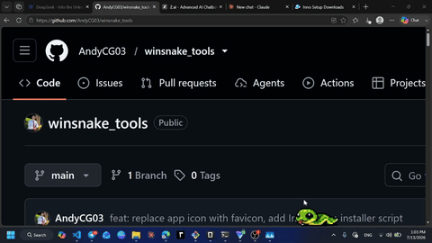

# WinSnake Tools

<p align="center">
  
</p>

Widget de escritorio para Windows con una mascota animada (**Serpiente** o **Capibara**) que camina sobre la barra de tareas, siempre visible encima de otras ventanas, con menú contextual de utilidades del sistema.

## Estado Actual

- **Versión:** 1.0.0
- **Plataforma:** Windows 10/11 (64-bit, Flutter Desktop)
- **Idiomas:** Español / Inglés (`ES` / `EN`)
- **Última actualización:** Octubre 2026

## Funcionalidades

| Opción | Descripción |
|--------|-------------|
| **Evitar suspensión** | Evita que la PC y el monitor entren en suspensión (`SetThreadExecutionState`) |
| **Dormir** | La mascota se queda quieta y duerme (animación en bucle con sprites `7.png`, `8.png`, `9.png`) |
| **Abrir carpeta** | Abre carpetas frecuentes del sistema con Windows Explorer |
| **Abrir programa** | Ejecuta programas y accesos rápidos guardados (`.exe`) |
| **Temporizador** | Cuenta regresiva (hasta 180 min) con presets rápidos (`5m`, `15m`, `25m`, `45m`, `60m`), badge en vivo, alerta visual y sonido del sistema |
| **Nota rápida** | Notas adhesivas tipo post-it con selector de 8 colores, paginación y cierre automático opcional |
| **Configuración** | Velocidad, opacidad, tamaño (`Pequeño` / `Normal`), mascota (`Serpiente` / `Capibara`), idioma (`ES` / `EN`), auto-inicio con Windows y gestión de rutas |
| **Salir** | Limpia los estados de energía de Windows y cierra la aplicación |

## Controles y Comportamiento

- **Hover sobre la mascota**: Se detiene y cambia al sprite de espera (`4.png`).
- **Clic sobre la mascota**: Abre o cierra el menú de opciones.
- **Acciones espontáneas**: Mientras camina, puede detenerse brevemente, asustarse o dar un salto espontáneo (`5.png`).
- **Adaptación automática de pantalla**: Detecta cambios de resolución o de posición de la barra de tareas (`didChangeMetrics`) y reposiciona la mascota automáticamente.
- **Renderizado sin parpadeo**: Precarga todos los sprites en memoria y utiliza `gaplessPlayback` con anclaje inferior para evitar recortes al iniciar o al cambiar de estado.

## Sprites

Cada mascota (`assets/img/serpiente/` y `assets/img/Capybara/`) utiliza la misma convención de archivos:

| Imagen | Propósito |
|--------|-----------|
| `1.png` | Frame 1 de caminata |
| `2.png` | Frame 2 de caminata |
| `3.png` | Frame 3 de caminata |
| `4.png` | Hover / espera / asustado |
| `5.png` | Alerta de temporizador / salto espontáneo |
| `6.png` | Anticipo de giro en los bordes |
| `7.png` | Frame 1 de dormir |
| `8.png` | Frame 2 de dormir |
| `9.png` | Frame 3 de dormir |

## Configuración y Persistencia

Los datos se almacenan automáticamente en `%APPDATA%\winsnake_tools\storage.json`:
- Velocidad de movimiento (`0.3` a `3.0`)
- Opacidad (`20%` a `100%`, aplicada únicamente a la mascota)
- Tamaño (`0.4` pequeño / `0.5` normal)
- Mascota activa (`serpiente` / `Capybara`)
- Idioma (`es` / `en`)
- Cierre automático de notas tras 5 segundos
- Inicio automático con Windows sincronizado con el registro `HKCU\Software\Microsoft\Windows\CurrentVersion\Run` (`WinSnakeTools`)
- Lista de carpetas, programas y notas guardadas

## Requisitos de Desarrollo

- **SO:** Windows 10+ (64-bit)
- **Flutter SDK:** 3.38+
- **Dart SDK:** 3.10.7+
- **Dependencias:** `window_manager: ^0.3.9`, `screen_retriever: ^0.1.9`, `win32: ^5.13.0`, `ffi`

## Compilación y Pruebas

```bash
# Instalar dependencias
flutter pub get

# Analizar código y ejecutar pruebas
flutter analyze
flutter test

# Compilar versión Release para Windows
flutter build windows --release
```

El ejecutable optimizado se genera en `build\windows\x64\runner\Release\winsnake_tools.exe`.

## Crear Instalador (Inno Setup)

Con [Inno Setup 6](https://jrsoftware.org/isdl.php) instalado:

```powershell
& "C:\Program Files (x86)\Inno Setup 6\ISCC.exe" "installer\setup.iss"
```

El instalador se genera en `installer\output\winsnake_tools_setup_v1.0.0.exe`.

## Instalación para Usuarios

1. Descarga el instalador desde [Releases](https://github.com/AndyCG03/winsnake_tools/releases) o desde `installer/output/winsnake_tools_setup_v1.0.0.exe`.
2. Ejecuta `winsnake_tools_setup_v1.0.0.exe`.
3. Tu mascota aparecerá sobre la barra de tareas lista para acompañarte.

## Estructura del Proyecto

```text
lib/
├── main.dart                  # Punto de entrada, inicialización de ventana frameless transparente
├── winsnake_widget.dart       # Widget principal, física de caminata, estados, notas y diálogo de config
├── menu_widget.dart           # Menú contextual oscuro con switches de energía y sueño
├── storage.dart               # Persistencia JSON en %APPDATA%\winsnake_tools\storage.json
├── traduccion.dart            # Diccionario de internacionalización (ES/EN)
├── servicios/
│   └── windows_services.dart  # FFI Win32: SetThreadExecutionState, Registro HKCU\Run, MessageBeep
└── opciones/
    ├── temporizador.dart      # Temporizador con Stream, presets rápidos y diálogo
    └── nota_rapida.dart       # Servicio de notas rápidas persistentes
assets/
├── gif/
│   └── winsnake.gif           # Demostración animada
└── img/
    ├── serpiente/             # Sprites de la serpiente (1.png .. 9.png)
    └── Capybara/              # Sprites del capibara (1.png .. 9.png)
windows/
└── runner/                    # Runner nativo C++ / Win32
installer/
├── setup.iss                  # Script de Inno Setup 6
└── output/                    # Instaladores compilados (.exe)
```

## Licencia

**MIT License** © 2026 AndyCG03

Se concede permiso, libre de cargos, a cualquier persona que obtenga una copia de este software y de los archivos de documentación asociados, para utilizar, copiar, modificar, fusionar, publicar, distribuir, sublicenciar y/o vender copias del Software, y a permitir a las personas a las que se les proporcione el Software a hacer lo mismo, sujeto a las siguientes condiciones:

El aviso de copyright anterior y este aviso de permiso se incluirán en todas las copias o partes sustanciales del Software.

EL SOFTWARE SE PROPORCIONA "TAL CUAL", SIN GARANTÍA DE NINGÚN TIPO, EXPRESA O IMPLÍCITA.

